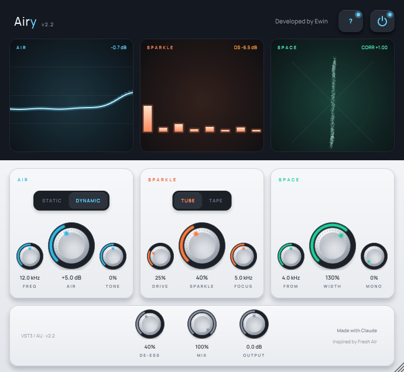

# Airy v2.2

A vocal "air" enhancer plugin: high-shelf air with a dynamic mode, harmonic sparkle (tube or tape), a built-in de-esser and a mono-safe stereo widener.

Developed by Ewin. Made with Claude, inspired by Fresh Air.



## Download

Go to **[Releases](../../releases)** and download:

| Your computer | File | Formats |
|---|---|---|
| Windows | `Airy-v2.2-Windows-VST3.zip` | VST3 (Cubase, FL Studio, Ableton, Reaper...) |
| Mac | `Airy-v2.2-Mac-AU-VST3.zip` | AU for Logic Pro / GarageBand, plus VST3 (Intel and Apple Silicon) |

Each zip has an install guide inside.

### Windows
Copy `Airy v2.2.vst3` to `C:\Program Files\Common Files\VST3`, then rescan plugins in your DAW.

### Mac (Logic Pro)
1. Copy `Airy v2.2.component` to `~/Library/Audio/Plug-Ins/Components` (and `Airy v2.2.vst3` to `~/Library/Audio/Plug-Ins/VST3` if you use a VST3 host).
2. The plugin isn't signed with an Apple Developer account, so run this once in Terminal:
   ```
   xattr -dr com.apple.quarantine ~/Library/Audio/Plug-Ins/Components/"Airy v2.2.component" ~/Library/Audio/Plug-Ins/VST3/"Airy v2.2.vst3"
   ```
3. Open Logic. If Airy doesn't appear: Logic Pro > Settings > Plug-in Manager > Reset & Rescan Selection.

## Controls

| Section | Controls |
|---|---|
| Air | Freq, Air, Tone, Static/Dynamic |
| Sparkle | Drive, Sparkle, Focus, Tube/Tape |
| Space | From, Width, Mono |
| Output | De-ess, Mix, Output |

Hover over any control for a short explanation (turn tips off with the `?` button). Drag the bottom-right corner to resize the window.

## Building from source

Every push is built automatically by GitHub Actions on Windows and macOS (see `.github/workflows/build.yml`). Pushing a tag like `v2.2.0` publishes a release with both zips.

To build locally you need CMake 3.22+ and a C++17 compiler (Visual Studio 2022 on Windows, Xcode on Mac). JUCE 7.0.12 is downloaded automatically.

```
cmake -B build -DCMAKE_BUILD_TYPE=Release
cmake --build build --config Release
```

## License

Airy is released under the GNU General Public License v3.0 (see `LICENSE`). It's built with [JUCE](https://juce.com) under its GPLv3 option. The Manrope font is under the SIL Open Font License (see `fonts/OFL.txt`).
